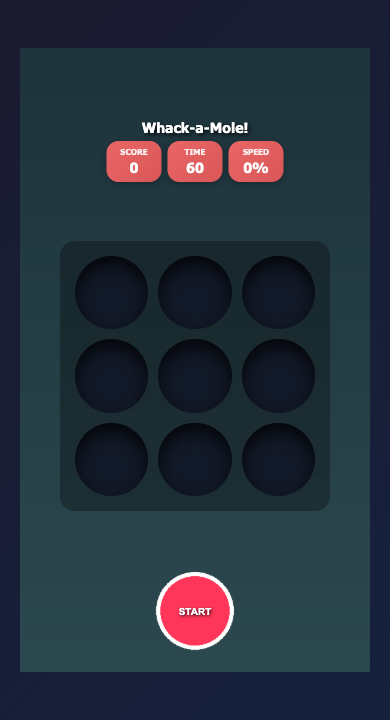
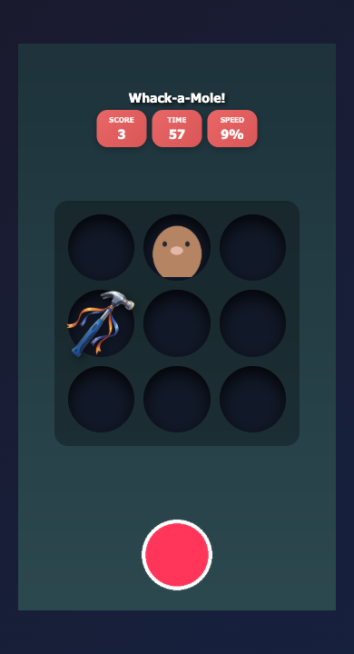
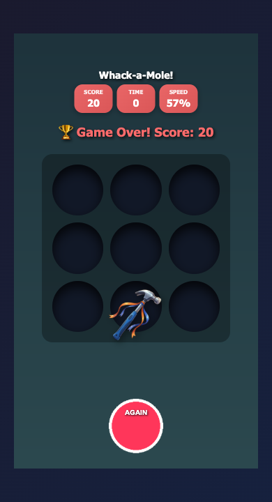

# Social mini-games · Whack-a-Mole

A 60-second tap game built for a phone screen. Each hit earns a point and makes the next target appear sooner. Three milestone pauses give the player a moment to breathe before the clock starts again.

<table>
  <tr><th>Start the round</th><th>Catch a target</th><th>See the result</th></tr>
  <tr>
    <td></td>
    <td></td>
    <td></td>
  </tr>
</table>

## Play

Clone the repository and run the game with Python 3:

```sh
git clone https://github.com/Dror-Bengal/social-mini-games.git
cd social-mini-games
python3 -m http.server 18794 --bind 127.0.0.1 --directory games/whack-a-mole
```

Open [the game on this computer](http://localhost:18794). Press **START**, then tap or click the holes as targets appear. At 10, 15 and 20 points, press **Continue** to resume. The round ends after 60 seconds of active play. **AGAIN** starts a new round at zero. All art, code and sound generation run locally. As an alternative to the Python command, run `docker compose up -d --build` from the repository root.

## About this edition

The collection currently contains one verified browser game from the TikTok-style demo. It uses the original HTML game, board, hammer, scoring rules, milestones and end screen. The portfolio edition replaces the portrait, title, camera background and campaign-specific messages. The previews above are captures of a round played in this edition. The tap target aligns with the visible start button, the speed indicator starts at zero, and audio is optional.

## Replay the browser checks

With the game running at the local address above, install Playwright in a virtual environment:

```sh
python3 -m venv .venv
. .venv/bin/activate
pip install playwright
python -m playwright install chromium
python tests/play_round.py --touch
python tests/play_round.py
```

The two commands exercise touch input and mouse input respectively. Each plays a full round in real time, scores twenty hits using the rendered controls, checks that every milestone pauses the timer, verifies the final score at zero seconds, and scores again after restarting. To save fresh mobile previews, add `--capture docs` to the touch command. To test with installed Chrome, set `BROWSER_CHANNEL=chrome`.

## License

Nayto’s code is distributed under the [MIT License](LICENSE). Third-party software and media retain their respective terms.
